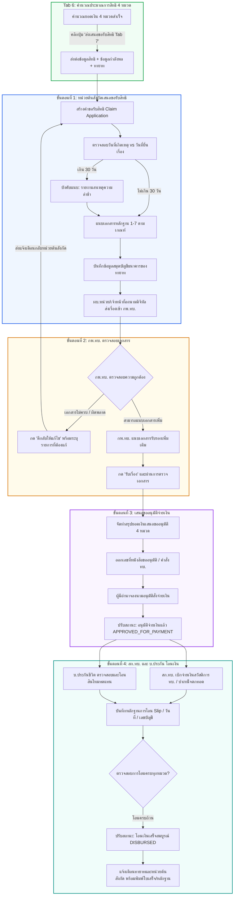

# เอกสารวิเคราะห์และออกแบบระบบ (System Analysis & Design Specification)
## ระบบเสนอขอรับสิทธิและสวัสดิการกำลังพล กองทัพบก (Tab 7: Benefit Claims & Disbursement Workflow)

---

### 1. ภาพรวมและหลักการออกแบบ (Overview & Objective)

ระบบ **"เสนอขอรับสิทธิและสวัสดิการ (Tab 7)"** ถูกออกแบบให้เป็นขั้นตอนต่อเนื่องโดยตรงหลังจาก **Tab 6 (การคำนวณประมาณการสิทธิกำลังพล 4 หมวด)** เพื่อเปลี่ยนตัวเลขประมาณการสิทธิให้เป็น **"คำขอรับเงินสวัสดิการและเงินสินไหมทดแทนจริงทางราชการ"** โดยเชื่อมโยงหน่วยงานที่เกี่ยวข้อง 4 ภาคส่วนอย่างเป็นเอกภาพ ได้แก่:
1. **หน่วยต้นสังกัดของกำลังพล** (กองพัน / กรม / กองพล / หน่วยเฉพาะกิจ)
2. **กรมกำลังพลทหารบก (กพ.ทบ.)** (หน่วยตรวจสอบคุณสมบัติ สิทธิ และเอกสารหลักฐาน)
3. **ผู้บังคับบัญชาผู้มีอำนาจอนุมัติ** (ผบ.ทบ. / เจ้ากรมกำลังพลทหารบก / คณะกรรมการสิทธิฯ)
4. **กรมสวัสดิการทหารบก (สก.ทบ.) และ บริษัทประกันชีวิต** (หน่วยดำเนินการเบิกจ่ายเงินสวัสดิการ ทบ. และเงินสินไหมทดแทน)

---

### 2. แผนผังกระบวนการทำงานรวม (End-to-End Workflow Diagram)



---

### 3. รายละเอียดกระบวนการ 4 ขั้นตอน (Detailed Stage Specifications)

#### ขั้นตอนที่ 1: หน่วยต้นสังกัดเสนอขอรับสิทธิ (Unit Submission)
* **ผู้รับผิดชอบ (Actor):** นายทหารฝ่ายกำลังพลประจำหน่วย (S1 / ผช.นายทหารกำลังพล / เจ้าหน้าที่สวัสดิการหน่วย)
* **ฟังก์ชันการทำงาน:**
  1. ดึงผลการคำนวณจาก Tab 6 เข้าสู่แบบฟอร์มคำขอโดยอัตโนมัติ (ยอดเงินก้อน, เงินรายเดือน, เงินรายปี, สิทธิมิใช่ตัวเงิน)
  2. จัดเก็บข้อมูลบัญชีธนาคารสำหรับโอนเงินให้ทายาทแต่ละท่าน (ธนาคาร, สาขา, เลขบัญชี, ชื่อบัญชี, สัดส่วน %)
  3. ระบบคำนวณอายุความอัตโนมัติ: ระยะเวลา = วันที่ยื่นเสนอ - วันที่เกิดเหตุ/เสียชีวิต
     * หาก **<= 30 วัน**: แนบเอกสารหลักฐานข้อ 1-7
     * หาก **> 30 วัน**: ระบบจะขึ้นแถบเตือนสีส้ม และบังคับกรอก/แนบ **"เอกสารข้อ 8: รายงานชี้แจงสาเหตุความล่าช้า"**
* **รายการเอกสารหลักฐาน (Document Checklist - 8 รายการ):**
  | ลำดับ | รายการเอกสาร | ความจำเป็น | รูปแบบไฟล์ที่รองรับ | รายละเอียดที่ต้องตรวจสอบ |
  | :--- | :--- | :---: | :---: | :--- |
  | 1 | **ใบมรณบัตร** | บังคับ (กรณีเสียชีวิต) | PDF, JPG, PNG | ตรวจสอบชื่อ-สกุล, สาเหตุการตาย, วันเวลาที่ถึงแก่กรรม |
  | 2 | **สำเนาทะเบียนบ้าน (ผู้ตาย)** | บังคับ | PDF, JPG, PNG | แสดงสถานะ "ตาย" และจำหน่ายชื่อออกจากทะเบียน |
  | 3 | **หนังสือแสดงเจตนาระบุผู้รับเงิน** | บังคับ | PDF, JPG, PNG | หนังสือแสดงเจตนาตามแบบ ทบ. ระบุสัดส่วนผู้รับผลประโยชน์ |
  | 4 | **สำเนาบัตร ปชช. (ผู้รับเงิน/ทายาท)** | บังคับ | PDF, JPG, PNG | บัตรยังไม่หมดอายุ พร้อมลงนามรับรองสำเนาถูกต้อง |
  | 5 | **สำเนาทะเบียนบ้าน (ผู้รับเงิน/ทายาท)** | บังคับ | PDF, JPG, PNG | ที่อยู่ปัจจุบันของทายาทผู้มีสิทธิรับเงิน |
  | 6 | **สำเนาสอบสวนตำรวจ / บันทึกประจำวัน** | บังคับ | PDF, JPG, PNG | รายงานประจำวันเกี่ยวกับคดีแสดงข้อเท็จจริงการเสียชีวิตขณะปฏิบัติหน้าที่ |
  | 7 | **สำเนาสมุดบัญชีเงินฝากของทายาท** | บังคับ | PDF, JPG, PNG | เก็บข้อมูลชื่อธนาคาร, เลขที่บัญชี, ชื่อบัญชีตรงกับทายาท |
  | 8 | **รายงานสาเหตุความล่าช้า** | เงื่อนไข (กรณีเกิน 30 วัน) | PDF | คำชี้แจงจาก ผบ.หน่วย สาเหตุที่ไม่สามารถยื่นภายใน 30 วัน |

---

#### ขั้นตอนที่ 2: กพ.ทบ. ตรวจสอบรายการเอกสาร (DOP Army Verification)
* **ผู้รับผิดชอบ (Actor):** เจ้าหน้าที่ตรวจสิทธิและสวัสดิการ กรมกำลังพลทหารบก (กพ.ทบ.)
* **ฟังก์ชันการทำงาน:**
  1. หน้าจอ **Document Inspection Checklist**: สามารถคลิกพรีวิวดูเอกสารแต่ละไฟล์ได้แบบ side-by-side
  2. กพ.ทบ. สามารถ **แนบเอกสารเพิ่มเติมได้** (เช่น หนังสือรับรองการปฏิบัติราชการสนามจาก กองทัพภาค, คำสั่งบรรจุอัตราศึก)
  3. ปุ่มตัดสินใจ 2 รูปแบบ:
     * **ปุ่ม "รับเรื่องและอนุมัติเอกสาร (Accept & Pass)":** เอกสารครบถ้วน ส่งเรื่องเข้าสู่ขั้นตอนที่ 3 ขออนุมัติจ่ายเงิน
     * **ปุ่ม "ตีกลับให้แก้ไข (Return for Modification)":** เปิดหน้าต่างให้ กพ.ทบ. ติ๊กเลือกว่าเอกสารข้อใดไม่ผ่าน พร้อมพิมพ์ระบุรายละเอียดเหตุผล (เช่น *"สำเนาสมุดบัญชีไม่ชัดเจน กรุณาถ่ายหน้าสมุดบัญชีใหม่"* หรือ *"หนังสือแสดงเจตนายังไม่มีพยานลงนามครบถ้วน"*)
  4. เมื่อถูกตีกลับ สถานะจะเปลี่ยนเป็น `RETURNED_FOR_EDIT` และระบบจะส่งสัญญาณให้หน่วยต้นสังกัดเห็นจุดที่ต้องแก้ทันที

---

#### ขั้นตอนที่ 3: เสนอขออนุมัติจ่ายเงิน (Payment Approval)
* **ผู้รับผิดชอบ (Actor):** เจ้าหน้าที่ กพ.ทบ. ฝ่ายนโยบายและส่งกำลัง / ผู้บังคับบัญชาผู้มีอำนาจลงนาม
* **ฟังก์ชันการทำงาน:**
  1. สร้าง **"ใบสรุปรายงานเสนอขออนุมัติจ่ายเงินสวัสดิการและสิทธิตามกฎหมาย"**
  2. รวบรวมยอดเงินสุทธิแยกเป็นรายหมวด:
     * หมวดที่ 1: เงินก้อนครั้งเดียว (เงินช่วยพิเศษ, บำเหน็จตกทอด, เงินประกันชีวิต ทบ.)
     * หมวดที่ 2: เงินรายเดือน (เงินเดือนตกเบิก, เงินบำนาญพิเศษ)
     * หมวดที่ 3: เงินรายปี (ทุนการศึกษาบุตร)
     * หมวดที่ 4: สิทธิมิใช่ตัวเงิน (บรรจุทายาททดแทน 1 อัตรา)
  3. บันทึกข้อมูลการอนุมัติ:
     * เลขที่หนังสือสั่งการ / เลขที่คำสั่งอนุมัติ (เช่น กห 0401/...)
     * วันที่อนุมัติ
     * ตำแหน่งผู้มีอำนาจอนุมัติ (เช่น เจ้ากรมกำลังพลทหารบก ปฏิบัติราชการแทน ผบ.ทบ.)
     * แนบไฟล์คำสั่งอนุมัติที่มีลายมือชื่อ
  4. ปรับสถานะเป็น `APPROVED_FOR_PAYMENT` ส่งเรื่องต่อไปยัง สก.ทบ. และ บริษัทประกันภัย

---

#### ขั้นตอนที่ 4: สก.ทบ. และ บริษัทประกัน ตรวจสอบและโอนเงิน (Disbursement & Insurance Settlement)
* **ผู้รับผิดชอบ (Actor):** 
  * นายทหารการเงิน กรมสวัสดิการทหารบก (สก.ทบ.)
  * ตัวแทนเจ้าหน้าที่ฝ่ายสินไหม บมจ.เมืองไทยประกันชีวิต / ธนชาตประกันภัย (ประกันภัย ทบ.)
* **ฟังก์ชันการทำงาน:**
  1. แยกแท็บการจ่ายเงินตามหมวดหมู่อย่างชัดเจน:
     * **ฝั่ง สก.ทบ.:** เงินสวัสดิการสงเคราะห์ ทบ., เงินทุนการศึกษา, เงินฌาปนกิจสงเคราะห์ ทบ.
     * **ฝั่ง บริษัทประกัน:** เงินสินไหมทดแทนประกันชีวิตทหาร (ภัยสงคราม / ปฏิบัติหน้าที่พิเศษ)
  2. การบันทึกธุรกรรมการโอนเงิน (Disbursement Record):
     * วันที่และเวลาที่โอนเงิน
     * ธนาคารต้นทาง -> ธนาคารปลายทาง
     * เลขที่อ้างอิงธุรกรรม (Transaction Ref No.)
     * อัปโหลดสลิปหลักฐานการโอนเงิน (Payment Slip)
  3. การปรับสถานะ:
     * `PARTIALLY_DISBURSED`: โอนแล้วบางรายการ (เช่น ประกันโอนแล้ว สก.ทบ. อยู่ระหว่างเบิกกรมบัญชีกลาง)
     * `DISBURSED_COMPLETED`: โอนเงินครบถ้วนทุกรายการเสร็จสมบูรณ์
  4. ระบบส่ง Notification ไปยังหน่วยต้นสังกัดและทายาท พร้อมพิมพ์ **"ใบแจ้งการจ่ายเงินสิทธิสวัสดิการกำลังพล"**

---

### 4. การออกแบบโครงสร้างฐานข้อมูล (Database Schema Extension)

```prisma
// ส่วนขยายโมเดลสำหรับขั้นตอนที่ 1-4 (Tab 7)

enum ClaimStage {
  UNIT_SUBMISSION      // 1. หน่วยต้นสังกัดเสนอขอรับสิทธิ
  DOP_VERIFICATION     // 2. กพ.ทบ. ตรวจสอบเอกสาร
  PAYMENT_APPROVAL     // 3. ขออนุมัติจ่ายเงิน
  DISBURSEMENT_SETTLED // 4. สก.ทบ. และ บ.ประกัน โอนเงิน
}

enum ClaimStatus {
  DRAFT                    // ร่างคำขอ
  SUBMITTED_TO_DOP         // ยื่นเรื่องถึง กพ.ทบ. แล้ว
  RETURNED_FOR_EDIT        // กพ.ทบ. ตีกลับให้แก้ไข
  DOP_VERIFIED             // กพ.ทบ. ตรวจสอบเอกสารผ่านแล้ว
  PENDING_COMMANDER_APP    // รอผู้มีอำนาจลงนามอนุมัติ
  APPROVED_FOR_PAYMENT     // อนุมัติจ่ายเงินแล้ว
  PROCESSING_DISBURSEMENT  // อยู่ระหว่าง สก.ทบ. และ บ.ประกัน ดำเนินการโอน
  DISBURSED_COMPLETED      // โอนเงินเสร็จสมบูรณ์
  REJECTED                 // ไม่อนุมัติ
}

model BenefitClaimApplication {
  id                    String        @id @default(cuid())
  claimNumber           String        @unique // e.g. CLAIM-2569-00124
  personnelId           String
  estimateId            String?       // ลิงก์ย้อนกลับผลการคำนวณจาก Tab 6
  unitId                String?
  submittingUnitName    String        // หน่วยต้นสังกัดที่ยื่นเรื่อง
  submittingOfficerName String        // นายทหารผู้ยื่นเรื่อง
  submissionDate        DateTime      @default(now())
  
  // ตรวจสอบเงื่อนไข 30 วัน
  incidentDate          DateTime      // วันที่เกิดเหตุ/สูญเสีย
  daysFromIncident      Int           // จำนวนวันนับจากวันเกิดเหตุ
  isDelayedOver30Days   Boolean       @default(false)
  delayReasonExplanation String?      @db.Text // บันทึกสาเหตุความล่าช้า (กรณีเกิน 30 วัน)
  
  currentStage          ClaimStage    @default(UNIT_SUBMISSION)
  status                ClaimStatus   @default(SUBMITTED_TO_DOP)
  
  // ข้อมูลสิทธิ 4 หมวดที่ขอรับ
  requestedLumpSum      Float         @default(0.0)
  requestedMonthly      Float         @default(0.0)
  requestedScholarship  Float         @default(0.0)
  requestedNonMonetary  String?       @db.Text
  
  // ขั้นตอนที่ 2: บันทึกการตรวจของ กพ.ทบ.
  dopReviewerId         String?
  dopReviewerName       String?
  dopReviewedDate       DateTime?
  dopReturnComment      String?       @db.Text // เหตุผลการตีกลับให้แก้ไข
  dopAdditionalNotes    String?       @db.Text
  
  // ขั้นตอนที่ 3: บันทึกการอนุมัติจ่ายเงิน
  approvalOrderNumber   String?       // เลขที่หนังสือสั่งการอนุมัติ
  approverName          String?       // ชื่อผู้มีอำนาจอนุมัติ
  approverPosition      String?       // ตำแหน่ง
  approvedDate          DateTime?
  approvedTotalAmount   Float?
  approvalOrderFileUrl  String?
  
  // รายการเอกสารหลักฐาน 8 รายการ และเอกสารที่ กพ.ทบ. แนบเพิ่ม
  documents             ClaimDocument[]
  
  // ข้อมูลบัญชีธนาคารและการโอนเงิน (ขั้นตอนที่ 4)
  heirDisbursements     ClaimHeirDisbursement[]
  
  createdAt             DateTime      @default(now())
  updatedAt             DateTime      @updatedAt
}

model ClaimDocument {
  id                    String        @id @default(cuid())
  claimId               String
  claim                 BenefitClaimApplication @relation(fields: [claimId], references: [id], onDelete: Cascade)
  documentType          String        // DEATH_CERT, HOUSE_REG_DECEASED, BENEFICIARY_INTENT, ID_CARD_RECIPIENT, HOUSE_REG_RECIPIENT, POLICE_REPORT, BANK_BOOK, DELAY_REASON_REPORT, DOP_ADDITIONAL
  documentTitle         String        // ชื่อเอกสารภาษาไทย
  isRequired            Boolean       @default(true)
  fileUrl               String?
  fileName              String?
  fileSizeBytes         Int?
  uploadedByStage       ClaimStage    @default(UNIT_SUBMISSION)
  isVerifiedByDop       Boolean       @default(false)
  rejectionReason       String?       // สาเหตุที่เอกสารข้อนี้ไม่ผ่าน
  uploadedAt            DateTime      @default(now())
}

model ClaimHeirDisbursement {
  id                    String        @id @default(cuid())
  claimId               String
  claim                 BenefitClaimApplication @relation(fields: [claimId], references: [id], onDelete: Cascade)
  heirName              String
  heirNationalId        String
  relationship          String        // คู่สมรส, บุตร, บิดา, มารดา
  allocatedPercent      Float
  allocatedAmount       Float
  
  // ข้อมูลบัญชีธนาคาร
  bankName              String
  bankAccountNumber     String
  bankAccountHolderName String
  bankBookScanUrl       String?
  
  // การโอนเงิน (สก.ทบ. / บ.ประกัน)
  payerType             String        // WELFARE_DEPT (สก.ทบ.) หรือ INSURANCE_COMPANY (บ.ประกัน)
  isTransferred         Boolean       @default(false)
  transferredAmount     Float?
  transferredDateTime   DateTime?
  transactionRefNumber  String?
  transferSlipUrl       String?
  transferOfficerName   String?
  transferNotes         String?
}
```

---

### 5. การออกแบบส่วนติดต่อผู้ใช้งาน (UI / UX Specifications)

#### 5.1 การจัดวางใน Navigation Bar & Workflow Banner
1. **ในเมนู Sidebar:**
   * Tab 5: รายงานการสูญเสีย (กพ.3 / กพ.4)
   * Tab 6: คำนวณประมาณการสิทธิ 4 หมวด
   * **Tab 7: เสนอขอรับสิทธิและสวัสดิการ (Claims & Disbursement)** *(เพิ่มต่อท้าย Tab 6)*
   * Tab 8: ติดตามสถานะและใบเสร็จ (Tracking)
2. **ใน Workflow Stepper Banner (ทุกหน้าในระบบ):**
   * ปรับจาก 5-6 กล่อง เป็นการเพิ่ม:
   * **กล่อง 7: "Tab 7: เสนอขอรับสิทธิ" (4 สเต็ป: หน่วยต้นสังกัด ➔ กพ.ทบ. ➔ อนุมัติ ➔ โอนเงิน)**

#### 5.2 โครงสร้างหน้าจอ Tab 7 (`/claims`)
* **ส่วนบน (Top Metric Cards):**
  * รอยื่นเรื่อง/ตีกลับ (Unit Action Needed)
  * กพ.ทบ. กำลังตรวจเอกสาร (Pending DOP Review)
  * รออนุมัติจ่ายเงิน (Pending Approval)
  * รอ สก.ทบ. และ บ.ประกัน โอนเงิน (Pending Disbursement)
  * โอนเงินเสร็จสิ้นแล้ว (Completed)
* **ส่วนตารางคำขอ (Claims Data Table):**
  * ค้นหาตามเลขรับเรื่อง, เลขประจำตัวประชาชน, ชื่อกำลังพล, หน่วยต้นสังกัด
  * Badge แสดงสถานะและระยะเวลา (เช่น *"ยื่นใน 14 วัน (ปกติ)"* หรือ *"เกิน 30 วัน (มีรายงานล่าช้า)"*)
* **หน้าต่างฟอร์มยื่นคำขอ (Submission Modal / Form):**
  * Step 1: สรุปสิทธิ 4 หมวดจาก Tab 6
  * Step 2: เอกสารหลักฐาน 8 ช่องอัปโหลด (ระบบแสดงแถบสีแดงเมื่อเกิน 30 วันและยังไม่แนบรายงานล่าช้า)
  * Step 3: กรอกข้อมูลสมุดบัญชีธนาคารทายาท
  * Step 4: สรุปและลงนามดิจิทัลส่งเรื่อง
* **หน้าต่างพิจารณาของ กพ.ทบ. (DOP Inspection Drawer/Modal):**
  * ตัวแสดงไฟล์เอกสาร (PDF Viewer) ข้างๆ รายการติ๊กถูก/ผิด
  * ช่องพิมพ์ข้อความระบุจุดที่ต้องแก้ไขหากกด "ตีกลับ"
  * ปุ่มแนบเอกสารเพิ่มเติมของ กพ.ทบ.
* **หน้าต่างบันทึกการโอนเงิน (Disbursement Dialog):**
  * แยก 2 ส่วนชัดเจน: กรมสวัสดิการทหารบก (สก.ทบ.) และ บริษัทประกันภัย
  * อัปโหลดสลิปโอนเงิน + บันทึกเลขอ้างอิงธนาคาร
